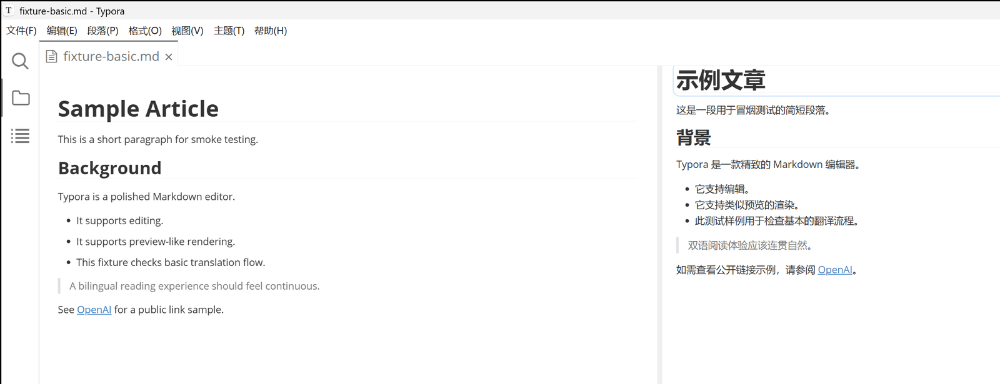

# Typora Side-by-Side Translator

Edit the original Markdown in Typora while reading a generated Chinese, English, Japanese, or Korean translation beside it.

[简体中文](./README.zh-CN.md)



_Live capture from Typora 1.14.9 on Windows: source editing remains native on the left, while the cached read-only translation stays beside it._

> **Alpha:** the core workflow is verified on Windows. Installation and side-by-side use have been smoke-tested on Apple Silicon. The plugin is not yet available in the community marketplace.

Current development version: **`0.1.0-alpha.3`**. The installed version is also shown at the top of the plugin settings page.

## Why This Plugin

- **Stay in Typora.** The left side remains Typora's native editor; the right side is a read-only translation pane.
- **Translate deliberately.** No request is sent while you type. Full translation and stale-block refresh are explicit commands.
- **Keep source folders clean.** Each target language has an independent plugin cache. Export creates a clean language-suffixed Markdown file only when requested.
- **Choose the target language.** Simplified Chinese, Traditional Chinese, English, Japanese, and Korean are available from both settings and the translation pane.
- **Use the plugin in your language.** The interface can follow Typora automatically or use English, Simplified Chinese, Traditional Chinese, Japanese, or Korean independently of the translation target.
- **Refresh only what changed.** Markdown blocks are tracked independently, while manually edited cached translations are protected from silent replacement.
- **Preserve Markdown structure.** Headings, paragraphs, lists, quotes, tables, links, code, math, and HTML follow type-specific translation rules.
- **Read as one document.** Both columns scroll together, with an adjustable split. Matched top-level blocks start at the same height, and clicking a matched translation jumps to its source block. Lists and tables align as a whole.

## Quick Start

### Requirements

| Platform | Status | Current evidence |
|---|---|---|
| Windows 10/11 | Supported Alpha | Typora 1.14.9 + `typora-community-plugin` 2.9.14 real-host smoke |
| macOS | Apple Silicon smoke-tested | Typora 1.14.15 + `typora-community-plugin` 2.10.86 on macOS 27.0.1 |
| Linux | Unsupported | No installer or host smoke |

The manifest minimums are Typora `1.12.4` and community core `2.5.28`; these are installation thresholds, not evidence that every newer host combination is verified. Source installation uses Node.js 24.

### Install a Published Alpha Release

Open the [Releases page](https://github.com/Eleef/typora-side-by-side-translator/releases) and download the assets for your platform from the same version into one directory. Windows requires `typora-community-plugin` to be installed first. If a release predates the one-command macOS installer, use the source-install path below.

Older Alpha releases contain only the Windows scripts.

- `plugin.zip`
- `SHA256SUMS.txt`
- `install-plugin.ps1`
- `doctor.ps1`
- `install-plugin-macos.sh`
- `doctor-macos.sh`

#### Windows

Completely close Typora, open PowerShell in that directory, and run:

```powershell
$checksumLine = Get-Content .\SHA256SUMS.txt | Where-Object { $_ -match '\s+plugin\.zip$' }
$expectedSha256 = ($checksumLine -split '\s+')[0]
powershell -NoProfile -ExecutionPolicy Bypass -File .\install-plugin.ps1 -PackagePath .\plugin.zip -ExpectedSha256 $expectedSha256
```

The installer checks the community loader, verifies the ZIP checksum and package structure, installs the plugin, enables it, and runs the post-install doctor.

Before upgrading an existing installation, check the API-key storage mode in plugin settings. A session-only key cannot survive closing Typora, so the installer stops and asks you to select **Save locally (plaintext, default)** first. If re-entering the key after installation is acceptable, explicitly append `-AcceptSessionCredentialLoss`. The installer verifies that persisted plugin settings are byte-for-byte unchanged by the upgrade.

#### macOS

Completely quit Typora (`Cmd+Q`), then run:

```bash
checksum=$(awk '$2 == "plugin.zip" { print $1 }' SHA256SUMS.txt)
bash ./install-plugin-macos.sh --with-community --package ./plugin.zip --expected-sha256 "$checksum"
```

Reopen Typora after installation. `--with-community` reuses a working loader or downloads a pinned, SHA-256-verified official community release. On a fresh installation or after a Typora update, the [official installer](https://github.com/typora-community-plugin/typora-community-plugin/blob/2.10.86/packages/installer/README.md#macos) modifies the app HTML. If macOS blocks that write, grant your terminal **System Settings → Privacy & Security → App Management** permission and rerun. The script backs up the original HTML, enables the translator, and preserves existing plugin settings. It does not re-sign the modified app. Intel uses the same JavaScript package but has not been host-tested.

### Install From Source

Completely quit Typora before installing. On Windows, install `typora-community-plugin` first.

Windows:

```powershell
npm ci
npm run ci
powershell -ExecutionPolicy Bypass -File .\scripts\doctor.ps1 -Mode Community
powershell -ExecutionPolicy Bypass -File .\scripts\install-plugin.ps1
```

The installer verifies that the community marketplace loader is present, copies the plugin, enables it without writing an incompatible UTF-8 BOM to `plugins.json`, and performs a post-install health check. The installed directory is:

```text
%USERPROFILE%\.typora\community-plugins\plugins\eleef.typora-side-by-side-translator
```

macOS (Node.js 24 or newer):

```bash
npm run install:macos
```

The default macOS plugin directory is:

```text
~/Library/Application Support/abnerworks.Typora/plugins/plugins/eleef.typora-side-by-side-translator
```

### Use

1. Open a saved local `.md` file in Typora.
2. Open the community plugin settings, choose the interface and target languages, then configure `baseUrl`, `apiKey`, `model`, and `timeoutMs`.
3. The API key is saved locally in plaintext plugin settings by default so it survives restarts and updates. Select **Do not save (current Typora session only)** when local-at-rest secrecy is more important than convenience.
4. Click the **Bilingual** translation icon in the left community toolbar to show or hide the pane. The plugin remembers your last toggle.
5. You can also run **Toggle Pane** in the community command panel. With the tested Mac core 2.10.86, press `F1` (or `Fn+F1`); the tested Windows setup uses `F2`.
6. Run **Translate Current File** to create the selected language's cached translation.
7. After editing the source, run **Refresh Stale Blocks** when you want changed blocks translated again. Translation reads the current editor content, including unsaved edits to a previously saved document.
8. Switch to another document while translation runs. The result is saved to the original document's cache, and you'll see the progress, translation, or error when you return. Use **Cancel Translation** in that document to stop its task without replacing its existing cache.
9. Run **Export Target File** to write a clean language-suffixed Markdown file beside the source file. If the translation no longer matches the current source, refresh or retranslate before exporting.

## How It Works

```text
saved Markdown
      |
      v
Markdown block extraction --> OpenAI-compatible /chat/completions endpoint
      |                                      |
      |                                      v
      +---------------------------- cached translation + map
                                             |
                           +-----------------+-----------------+
                           v                                   v
                    read-only right pane              clean *.zh.md export
```

The source language is detected by the configured model. The target is selected from Simplified Chinese (`.zh.md`), Traditional Chinese (`.zh-TW.md`), English (`.en.md`), Japanese (`.ja.md`), or Korean (`.ko.md`). Switching targets reads that language's independent cache and never sends a request automatically. OpenAI-compatible remote APIs and loopback-hosted local model services are supported. Code, math, and HTML blocks are kept without translation; link text may be translated while URLs remain unchanged.

YAML front matter remains a metadata block in the pane and at the start of exports. The plugin translates top-level text values of `title`, `description`, `summary`, `subtitle`, `abstract`, and `excerpt`, leaving other metadata unchanged. If the body of an older cached translation still matches the source, **Refresh Stale Blocks** translates only the missing front matter.

## Data Safety

- Markdown is sent only after **Translate Current File** or **Refresh Stale Blocks**.
- Before the first network translation, the plugin names the configured service and requires explicit data-transfer consent; declining sends nothing.
- Requests go directly from Typora to the configured provider; this project operates no proxy.
- Remote endpoints must use HTTPS. Plain HTTP is allowed only for `localhost`, `127.0.0.1`, and `::1`.
- Local plugin settings are the default and store the API key as plaintext in the current user's community plugin data; other programs running as the same operating-system user can read it. The optional session mode keeps the key only in memory and cannot recover it after closing, restarting, or updating Typora.
- Changing the API service origin clears both the in-memory and saved key. Switching back to session mode or using the explicit delete action also removes the saved value.
- Reinstalling or uninstalling plugin code does not remove community settings, caches, or logs. The upgrade installer verifies that persisted settings are unchanged; a session-only key still disappears when Typora closes. Use **Erase all local plugin data** in the plugin settings before uninstalling when local data must be removed.
- Translation cache is stored below the community plugin settings data directory: `%USERPROFILE%\.typora\community-plugins\settings\data\...` on Windows, or `~/Library/Application Support/abnerworks.Typora/plugins/settings/data/...` on macOS.
- **Clear current document** removes only the active target language's cache pair. The settings page can also clear all translation caches, diagnostic logs, or all plugin-local data; exported Markdown files are never deleted.
- Diagnostic logs redact credentials, local paths, URL query parameters, and sensitive error details.
- The read-only pane escapes raw Markdown HTML and sanitizes rendered output with a strict allowlist; executable markup and external resource elements are removed.

The configured API provider receives the Markdown blocks selected for translation. Review that provider's data handling terms before using sensitive documents. The saved consent can be removed together with all local plugin data.

After an interrupted save, the plugin restores a verified backup pair when available. If the remaining backups cannot be restored, the plugin leaves them untouched and asks you to back them up before clearing the cache. Older caches remain readable, but export requires a verifiable match to the current source and stale refresh cannot update a cache that uses an old block identity format.

## Current Limits

- Saved local `.md` files only; untitled and remote documents are unsupported.
- Source-language selection and automatic target-language routing are not provided; source detection is delegated to the configured model.
- The right pane is read-only and translation is not performed on every keystroke.
- The macOS smoke covers installation and side-by-side use on one Apple Silicon setup, not every scenario in the Windows verification matrix.
- Alpha installation is available from GitHub Releases; community marketplace installation is planned after the stable `0.1.0` release.

## Troubleshooting

Run the health check first:

```powershell
powershell -ExecutionPolicy Bypass -File .\scripts\doctor.ps1
```

On macOS:

```bash
bash ./scripts/doctor-macos.sh --redact-paths
```

Typora updates may replace the modified HTML, hiding all community plugins. If the doctor reports a `community-market.injection` failure, quit Typora and rerun the one-command installer to reattach the existing loader. Do not restore HTML from an older Typora version over the new version.

The plugin settings show the local **Diagnostics log** path. A Markdown protection error can occur even when the API returns HTTP 200: the plugin checks the returned Markdown before saving it. Missing spaces after closing bold markers can be repaired locally without another API call. For other formatting changes with intact protection markers, the plugin can send one extra request per translation command, across all batches, for at most two affected blocks, 24 text fragments, and 1,200 characters of source text. It rebuilds the original formatting locally. If it exceeds the limit or still cannot validate the result, it leaves the existing translation unchanged.

To correlate a failure with a gateway log, match the plugin's UTC timestamp against the request's completion time; the plugin log does not record request IDs or translation bodies.

When reporting a problem, rerun the doctor with `-RedactPaths`, then use the repository's Bug or Compatibility issue form and include that redacted summary, Typora version, community core version, and reproduction steps. Do not include API keys or unredacted logs.

## Development

```powershell
npm run typecheck
npm test
npm run build
npm run package
npm run test:windows-installer
npm run test:macos-installer
npm run version:set -- <version>
$env:RELEASE_TAG = "<version>"
npm run check:release
```

`npm run package` creates one architecture-neutral `release/plugin.zip` with `manifest.json`, `main.js`, `style.css`, and five interface-language resources under `locales/`. Windows and macOS installers validate the same package. See [VERIFICATION.md](./VERIFICATION.md) for the evidence matrix and the macOS real-host checks that remain open.

The repository includes [social-preview.png](./docs/assets/social-preview.png), sized for GitHub's repository social preview setting.

## License

[MIT](./LICENSE) © Eleef
